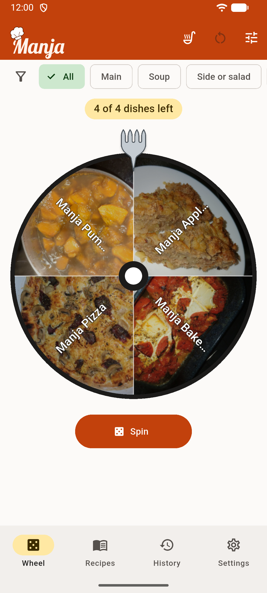
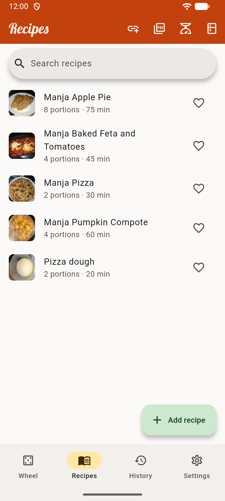
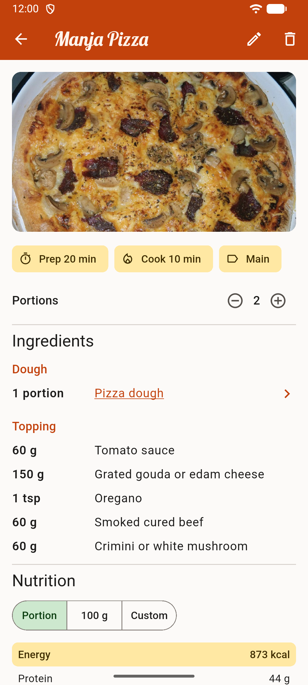
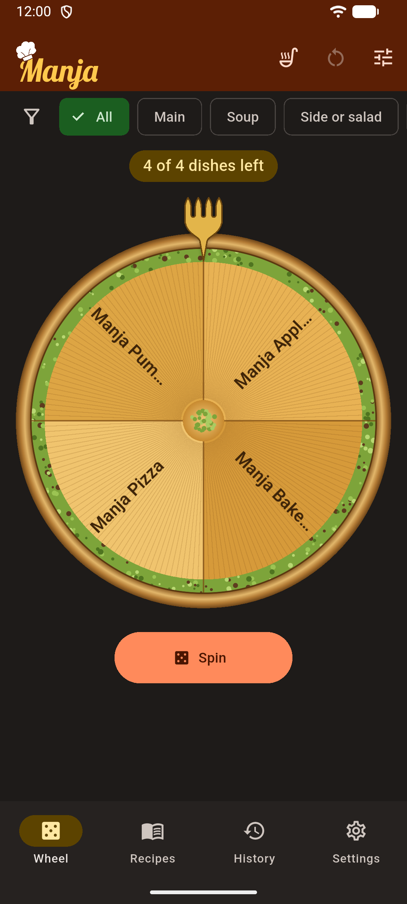

# Manja

**Can't decide what to cook? Spin the wheel.**

Manja is a free meal wheel and recipe book. Add the dishes you like, spin the wheel, and whatever you ate leaves the
wheel until the round is over. No account, no ads, no tracking: everything stays on your phone.

<p>
  
  
  
  
</p>

## Features

- **Meal wheel**: spin to pick a dish; eaten dishes leave the wheel until it refills (when everything was eaten,
  after a number of days, or by hand). Themes: Classic, Pizza, Burek, Sachertorte and Baklava.
- **Tags and filters**: spin only mains, desserts or your own groups, limit calories per portion or total cooking time.
- **Recipes**: ingredients in metric or imperial units, steps, portions, photos and favourites.
- **Import from a link**: paste a recipe page and Manja reads it (sites that publish schema.org recipe data).
- **Nutrition**: per portion or per 100 g, including vitamins and minerals with the EU daily reference intake.
  Built-in USDA data works offline; USDA and Open Food Facts can be searched online.
- **Barcode scanner**: scan a package and get its nutrition values from Open Food Facts.
- **What can I cook?**: tell Manja what you have at home and it shows the dishes you can make.
- **History**: what you ate and when, with search and dates.
- **Cookbook PDF**: print or share your recipes in three layouts.
- **Backup & move**: export everything to one `.manja` file and import it on another device.
- **Languages**: English, German and Bosnian; the app follows the phone or a language chosen in Settings.
- Light and dark mode, unit converter, and more.

## Install

Manja is in development. Android test builds (APK) are published under
[Releases](https://github.com/Zemo1337/manja/releases).

- Download `manja-x.y.z.apk` on your phone and open it. Android asks once to allow installing apps from your
  browser or file manager ("Install unknown apps"). Play Protect may say it does not know the developer; choose
  *Install anyway*.
- For automatic updates, add this repository to [Obtainium](https://github.com/ImranR98/Obtainium).

Android 7.0 or newer. iOS, Windows, Linux and macOS builds work from source but are not published yet.

## Privacy

Manja collects nothing. Recipes, photos and history are stored only on your device and in backup files you create.
The app uses the internet only when you ask it to: looking up ingredients at USDA or Open Food Facts, and importing
a recipe from a link. The camera is used only to scan barcodes and take recipe photos.

## Development

```bash
flutter pub get
dart run build_runner build --delete-conflicting-outputs
flutter test
flutter run
```

### USDA API key

Online ingredient search uses [USDA FoodData Central](https://fdc.nal.usda.gov/). Without a key the app uses USDA's
shared `DEMO_KEY`, which is limited to a few requests per hour. For development, get a free key at
[api.data.gov/signup](https://api.data.gov/signup/), then:

```bash
cp config/local.example.json config/local.json
```

Put the key into `config/local.json` (ignored by git, never commit it) and run with:

```bash
flutter run --dart-define-from-file=config/local.json
```

The VS Code launch configuration "Manja" does this automatically. Users can enter their own key in the app under
Settings → Ingredients & USDA key.

### Built-in ingredient data

`assets/food/usda.json.gz` holds the USDA Foundation and SR Legacy foods (about 8,000 foods, 514 KB) with energy,
macronutrients, vitamins and minerals. The app imports it on first start and again whenever the file's version
changes. To rebuild it from the bulk downloads at
[fdc.nal.usda.gov/download-datasets](https://fdc.nal.usda.gov/download-datasets):

```bash
cd packages/nutrition_usda && dart run tool/build_bundle.dart "FDC Foundation <date> + SR Legacy 2018-04, with vitamins and minerals" ../../assets/food/usda.json.gz <foundation.json> <sr_legacy.json>
```

The database layer uses [drift](https://drift.simonbinder.eu/). After changing tables in `lib/data/database.dart`,
rerun `build_runner`.

### Project layout

```
lib/
  data/       database, backups, recipe import, nutrition repository
  domain/     wheel, filters, pantry matching, cookbook PDF, units
  ui/         screens and widgets
test/         unit and widget tests
packages/
  nutrition_core/   nutrients, food sources, unit conversion, recipe nutrition (plain Dart)
  nutrition_usda/   USDA FoodData Central adapter and built-in data builder
  nutrition_off/    Open Food Facts adapter (barcodes and product search)
  recipe_import/    reads schema.org recipe data from web pages
```

Each package has its own tests: `cd packages/<name> && dart test`.

## Translations

The app's texts live in `lib/l10n/app_<language>.arb` (Flutter's [ARB format](https://docs.flutter.dev/ui/accessibility-and-internationalization/internationalization)).
To add a language:

1. Copy `lib/l10n/app_en.arb` to `app_<code>.arb` (e.g. `app_fr.arb`), set `"@@locale"` and translate the texts.
   The `@` entries in the English file describe where each text appears. Keep `{placeholders}` as they are, and
   fill the plural forms your language needs (`one`, `few`, `many`, `other`).
2. Optionally add `assets/food/search_<code>.json` with local names of common foods and the English words that find
   them in the built-in USDA data, so searching "farine" finds the wheat flour. See `search_de.json` for the format.
3. Run `flutter gen-l10n` and `flutter test`. The new language appears in Settings → Appearance by itself.

The store texts (F-Droid) are in `fastlane/metadata/android/<locale>/`; copy the `en-US` folder to translate them.

## Contributing

Bug reports and ideas are welcome as [issues](https://github.com/Zemo1337/manja/issues). For larger changes, please
open an issue first so we can talk about it.

## License

Manja is free software: you can redistribute it and/or modify it under the terms of the
[GNU Affero General Public License v3.0](LICENSE).

The name "Manja" and the Manja logo and wordmark are not covered by this license. If you publish a modified version,
please give it a different name and logo.

## Credits

- Nutrition data: [USDA FoodData Central](https://fdc.nal.usda.gov/) (public domain) and
  [Open Food Facts](https://world.openfoodfacts.org/) (Open Database License, © Open Food Facts contributors)
- Fonts: [Lobster](https://github.com/impallari/The-Lobster-Font) by Pablo Impallari (SIL Open Font License) and
  [Roboto](https://github.com/googlefonts/roboto) by Google (Apache License 2.0)
- Logo and wordmark drawn by the Manja family
- Built with [Flutter](https://flutter.dev) and many open-source packages; their licenses are listed in the app
